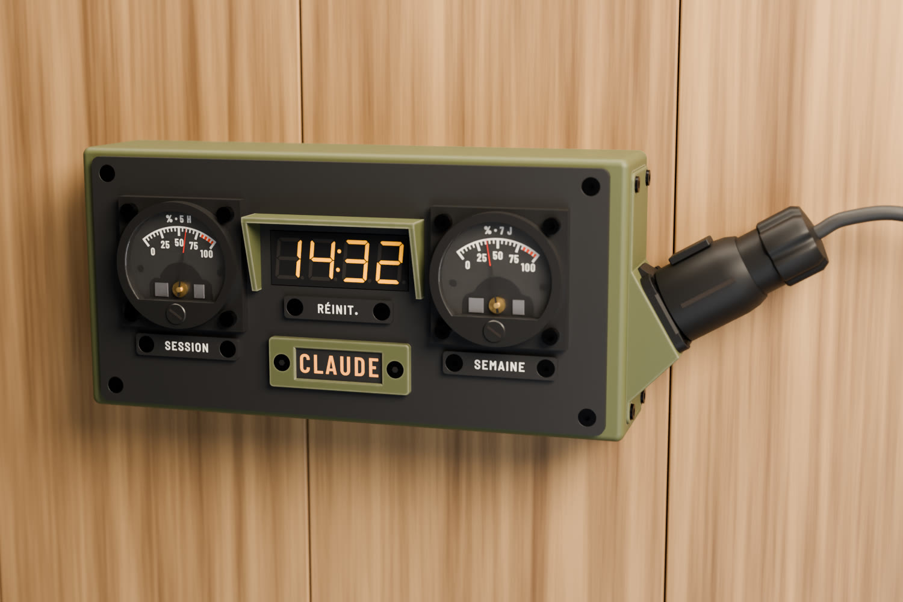
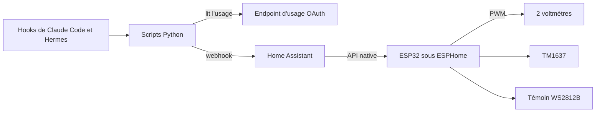
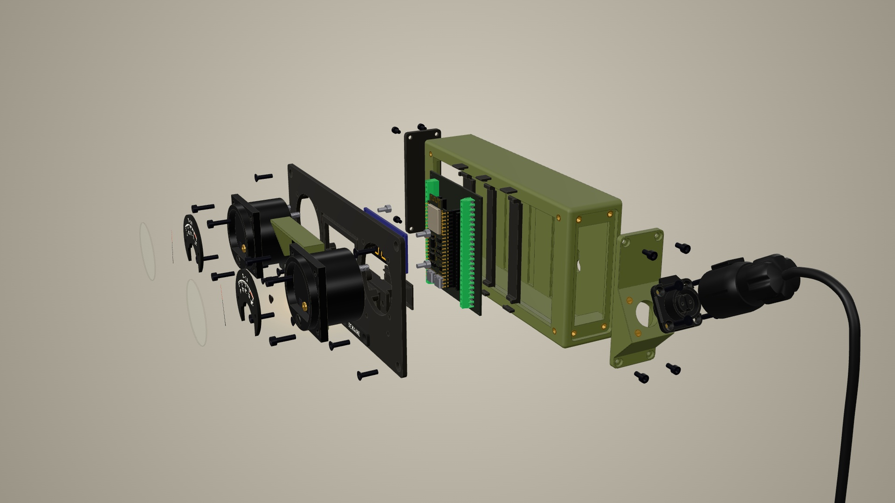

# Claudemètre

> English speakers: the docs and YAML comments are in French for now.

Un instrument de bord mural qui affiche l'usage de mon forfait Claude sur de vraies aiguilles : deux
voltmètres analogiques, un afficheur 7 segments et un témoin lumineux, pilotés en WiFi par un ESP32 sous
ESPHome, à travers Home Assistant.



**[Voir la maquette 3D interactive](https://docteurzoidberg.github.io/claudemetre/)**, assemblée ou éclatée,
pièce par pièce.

Ces images sont des rendus, l'objet réel tourne sur mon bureau. Deux différences avec lui : il est alimenté
en USB pour l'instant, sans le connecteur LP-16 des rendus, et son afficheur a un point (`14.32`), pas un
deux-points.

## Ce qu'il affiche

| Élément | Donnée |
| --- | --- |
| Jauge de gauche | % utilisé de la session (5 h glissantes) |
| Jauge de droite | % utilisé de la semaine |
| Afficheur 7 segments | heure de reset de la session (`14.32`) ou temps restant (`-2.07`), au choix depuis Home Assistant |
| Témoin CLAUDE | ambre qui respire : un agent travaille ; rouge qui clignote : un agent attend une réponse |

Au démarrage, les aiguilles font 0 → 100 → 0 %, le témoin passe de l'ambre au rouge et un trait fait le tour de
l'afficheur.

## Comment ça marche



Le PC pousse les données et l'ESP32 ne parle jamais à Anthropic : il n'a pas le jeton. Il n'y a pas de démon :
les scripts sont lancés par les hooks. Les chiffres viennent de l'endpoint derrière la commande `/usage` de
Claude Code, qui voit tout le compte (terminal, `claude -p`, claude.ai) et dont l'appel ne consomme aucun token.
Les valeurs restent disponibles comme capteurs ordinaires dans Home Assistant, avec une carte Lovelace assortie.

Quelques détails côté ESPHome :

- **Pas de DAC ni de pilote** : `ledc` à 25 kHz directement sur les voltmètres, le cadre mobile fait la moyenne.
- **Étalonnage depuis Home Assistant**, sans trimmer : 5 points par jauge en entités `number`. Changer un point
  amène l'aiguille dessus pendant 20 s, pour le régler à l'œil.
- **Aiguilles au rendu mécanique** : vitesse limitée, pleine échelle en 2,5 s environ.
- **Autonome entre deux envois** : l'ESP32 décompte seul, et au reset la jauge retombe à 0 sans attendre le PC.
- **Témoin réutilisable** : [`esphome/temoin.yaml`](esphome/temoin.yaml) est un paquet générique.

Le détail est dans [docs/logiciel.md](docs/logiciel.md) et [docs/source-donnees.md](docs/source-donnees.md).

## Ce qu'il faut

| Pièce | Qté | Remarque |
| --- | --- | --- |
| ESP32-S3-DevKitC-1 N16R8 (diymore) | 1 | |
| Carte à borniers MRD076A | 1 | l'ESP32 s'enfiche dessus, câblage vissé |
| Voltmètre analogique 0-5 V SO-45 | 2 | modifié, voir plus bas |
| Résistance 6,2 kΩ | 2 | une par voltmètre |
| Module TM1637 4 chiffres 0,56", jaune, à points décimaux | 1 | |
| Ruban WS2812B à 144 LED/m | 4 LED | |
| Diode 1N400x | 1 | sur le 5 V du ruban |
| Alimentation USB 5 V | 1 | |
| Vis M3 et inserts laiton | | liste dans le [cahier des charges](docs/cahier-des-charges.md) |

## Le construire



**1. Imprimer.** Les 3MF sont dans [`design/fusion/print/`](design/fusion/print/) et, pour le témoin, dans
[`design/temoin/export/`](design/temoin/export/). Tout est en PETG, sauf les plaquettes en PLA noir et blanc. Les
cadrans sont multi-filament.

**2. Préparer les voltmètres.** Une GPIO en 3,3 V n'amène un 0-5 V qu'aux deux tiers de sa course. On ramène la
pleine échelle vers 3 V en soudant une 6,2 kΩ en parallèle sur la résistance série interne. Les cadrans imprimés
remplacent ensuite la plaque d'origine. Mesures et calculs dans
[`design/references/so45/README.md`](design/references/so45/README.md).

**3. Câbler.**

| Broche | Vers |
| --- | --- |
| GPIO4 | `+` du voltmètre session, `−` à GND |
| GPIO5 | `+` du voltmètre semaine, `−` à GND |
| GPIO6 | TM1637 CLK |
| GPIO7 | TM1637 DIO |
| GPIO15 | DIN du ruban |
| 3V3 | VCC du TM1637 |
| 5V | alimentation, sur le bornier ; ruban à travers la diode, pour que le 3,3 V de DIN passe sans level shifter |

**4. Flasher le firmware.** Créer `esphome/secrets.yaml` avec `wifi_ssid`, `wifi_password` et
`api_encryption_key`, adapter le fuseau horaire de `time:`, puis :

```sh
esphome run esphome/claudemetre.yaml
```

**5. Configurer Home Assistant.** Installer le package [`homeassistant/packages/claudemetre.yaml`](homeassistant/packages/claudemetre.yaml),
la marche à suivre est en tête du fichier. Pour la carte, déclarer
[`claudemetre-card.js`](homeassistant/www/claudemetre/claudemetre-card.js) comme ressource, puis ajouter :

```yaml
type: custom:claudemetre-card
```

**6. Installer les hooks sur le PC.** Voir [`host/README.md`](host/README.md). Les scripts n'utilisent que la
bibliothèque standard de Python.

**7. Étalonner.** Ajuster les entités `Jauge session …` et `Jauge semaine …` jusqu'à ce que chaque aiguille tombe
sur le trait imprimé.

## Dans le dépôt

| Dossier | Contenu |
| --- | --- |
| `esphome/` | firmware |
| `homeassistant/` | package, carte Lovelace et son aperçu |
| `host/` | scripts lancés par les hooks, et leurs tests |
| `maquette/` | page 3D assemblée et éclatée |
| `design/` | fichiers d'impression, scripts Fusion et Blender, rendus, cadrans, plaquettes, modèles tiers |
| `docs/` | cahier des charges, partie logicielle, source des données, témoin, maquettes |

## Limites

- **Projet personnel, sans lien avec Anthropic.** L'endpoint d'usage n'est pas documenté : il peut changer ou
  disparaître.
- **Jeton en lecture seule.** Le script lit celui de Claude Code et ne le rafraîchit jamais, pour ne pas le
  déconnecter.
- **Pas de démon.** L'usage de claude.ai n'apparaît qu'au prochain déclenchement d'un hook.
- **Mis au point sous WSL2**, avec Home Assistant sur le réseau local. Le reste n'est pas testé.
- **Plaquettes en français** : SESSION, SEMAINE, RÉINIT. Le texte se régénère avec
  [`design/plaquettes/plaquettes_texte.py`](design/plaquettes/plaquettes_texte.py).
- **Rien n'est signalé sur l'objet** si les données sont périmées ou si le WiFi tombe.

Les questions ouvertes sont en fin de [cahier des charges](docs/cahier-des-charges.md).

## Fait avec Claude

Tout a été fait avec Claude : la CAO dans Fusion 360 et les rendus dans Blender, pilotés par MCP et par scripts,
le firmware ESPHome, la configuration Home Assistant, les fichiers d'impression et cette documentation. Je n'ai
rien modélisé, codé ni écrit à la main.

## Crédits

- Inspiré de [Clawdmeter](https://github.com/HermannBjorgvin/Clawdmeter), refait en WiFi et Home Assistant, sans
  Bluetooth ni écran.
- Témoin CLAUDE produit avec mon
  [générateur de témoins lumineux](https://docteurzoidberg.github.io/generateur-temoin-lumineux/) (en français,
  traduction prévue).
- Modèles 3D du commerce trouvés sur GrabCAD, listés dans [`design/references/grabcad.md`](design/references/grabcad.md).
- Polices Barlow, sous licence OFL.

## Licence

| Partie | Licence |
| --- | --- |
| Code : `esphome/`, `homeassistant/`, `host/`, le code de `maquette/`, les scripts de `design/` | [MIT](LICENSE) |
| Conception : fichiers d'impression, cadrans, rendus, scènes, `docs/` | [CC BY-SA 4.0](LICENSE-CC-BY-SA-4.0.txt) |
| Modèles tiers de `design/references/` | licence de leurs auteurs, voir [`grabcad.md`](design/references/grabcad.md) |
| Polices de `design/fonts/` | [OFL](design/fonts/OFL-Barlow.txt) |

Ces licences ne couvrent pas les modèles tiers intégrés à d'autres fichiers : maquette 3D, maillages et scènes
Blender.
