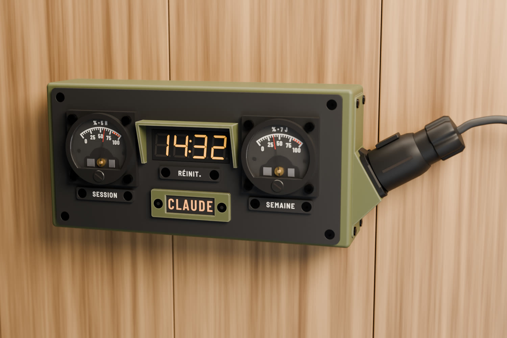
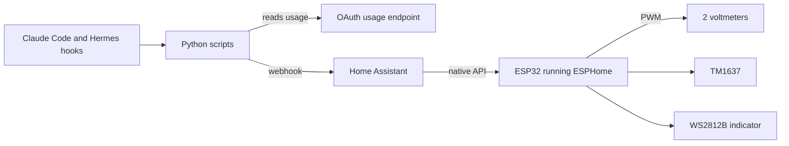
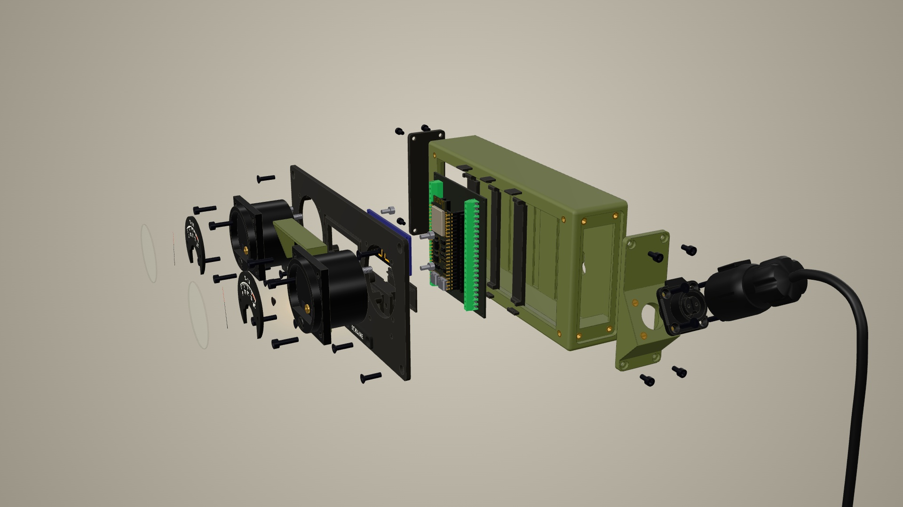

[🇫🇷 Version française](../../README.md)

# Claudemètre

> The code comments, YAML comments and sub-folder READMEs are in French for now.

A wall-mounted dashboard instrument that shows my Claude plan usage on real needles: two analog voltmeters,
a 7-segment display and an indicator light, driven over WiFi by an ESP32 running ESPHome, through Home
Assistant.



**[See the interactive 3D model](https://docteurzoidberg.github.io/claudemetre/)** (page in French), assembled
or exploded, part by part.

These images are renders; the real object runs on my desk. It differs in two ways: it is powered over USB for
now, without the LP-16 connector shown in the renders, and its display has a dot (`14.32`), not a colon.

## What it shows

| Element | Data |
| --- | --- |
| Left gauge | % of the session used (rolling 5 h) |
| Right gauge | % of the week used |
| 7-segment display | session reset time (`14.32`) or time remaining (`-2.07`), selectable from Home Assistant |
| CLAUDE indicator | breathing amber: an agent is working; blinking red: an agent is waiting for an answer |

At startup, the needles sweep 0 → 100 → 0 %, the indicator goes from amber to red and a line runs around the
display.

## How it works



The PC pushes the data and the ESP32 never talks to Anthropic: it doesn't have the token. There is no daemon:
the scripts are launched by the hooks. The numbers come from the endpoint behind Claude Code's `/usage` command,
which sees the whole account (terminal, `claude -p`, claude.ai) and whose call uses no tokens. The values stay
available as ordinary sensors in Home Assistant, with a matching Lovelace card.

A few details on the ESPHome side:

- **No DAC or driver**: `ledc` at 25 kHz straight into the voltmeters; the moving coil does the averaging.
- **Calibration from Home Assistant**, no trimmer: 5 points per gauge as `number` entities. Changing a point
  moves the needle onto it for 20 s, so you can set it by eye.
- **Mechanical-looking needles**: speed-limited, about 2.5 s for full scale.
- **Standalone between pushes**: the ESP32 counts down on its own, and at reset the gauge drops to 0 without
  waiting for the PC.
- **Reusable indicator**: [`esphome/temoin.yaml`](../../esphome/temoin.yaml) is a generic package.

Details are in [software.md](software.md) and [data-source.md](data-source.md).

## What you need

| Part | Qty | Note |
| --- | --- | --- |
| ESP32-S3-DevKitC-1 N16R8 (diymore) | 1 | |
| MRD076A terminal board | 1 | the ESP32 plugs into it, screw-terminal wiring |
| SO-45 0-5 V analog voltmeter | 2 | modified, see below |
| 6.2 kΩ resistor | 2 | one per voltmeter |
| TM1637 4-digit 0.56" module, yellow, with decimal points | 1 | |
| WS2812B strip, 144 LEDs/m | 4 LEDs | |
| 1N400x diode | 1 | on the strip's 5 V |
| 5 V USB power supply | 1 | |
| M3 screws and brass inserts | | listed in the [specification](specification.md) |

## Building it



**1. Print.** The 3MF files are in [`design/fusion/print/`](../../design/fusion/print/) and, for the indicator,
in [`design/temoin/export/`](../../design/temoin/export/). Everything is PETG, except the nameplates in black and
white PLA. The dials are multi-filament.

**2. Prepare the voltmeters.** A 3.3 V GPIO only takes a 0-5 V meter two thirds of the way. Soldering a 6.2 kΩ
resistor in parallel with the internal series resistor brings full scale down to about 3 V. The printed dials
then replace the original plate. Measurements and calculations are in
[`design/references/so45/README.md`](../../design/references/so45/README.md) (in French).

**3. Wire.**

| Pin | To |
| --- | --- |
| GPIO4 | session voltmeter `+`, `−` to GND |
| GPIO5 | week voltmeter `+`, `−` to GND |
| GPIO6 | TM1637 CLK |
| GPIO7 | TM1637 DIO |
| GPIO15 | strip DIN |
| 3V3 | TM1637 VCC |
| 5V | power supply, on the terminal block; strip through the diode, so the 3.3 V on DIN works without a level shifter |

**4. Flash the firmware.** Create `esphome/secrets.yaml` with `wifi_ssid`, `wifi_password` and
`api_encryption_key`, adjust the time zone under `time:`, then:

```sh
esphome run esphome/claudemetre.yaml
```

**5. Set up Home Assistant.** Install the package
[`homeassistant/packages/claudemetre.yaml`](../../homeassistant/packages/claudemetre.yaml); the instructions are
at the top of the file (in French). For the card, declare
[`claudemetre-card.js`](../../homeassistant/www/claudemetre/claudemetre-card.js) as a resource, then add:

```yaml
type: custom:claudemetre-card
```

**6. Install the hooks on the PC.** See [`host/README.md`](../../host/README.md) (in French). The scripts only use
the Python standard library.

**7. Calibrate.** Adjust the `Jauge session …` and `Jauge semaine …` entities (session and week gauges) until each
needle lands on the printed mark.

## In the repository

| Folder | Contents |
| --- | --- |
| `esphome/` | firmware |
| `homeassistant/` | package, Lovelace card and its preview |
| `host/` | scripts launched by the hooks, and their tests |
| `maquette/` | assembled and exploded 3D page |
| `design/` | print files, Fusion and Blender scripts, renders, dials, nameplates, third-party models |
| `docs/` | specification, software, data source, indicator, mockup; in French, with the English version in `docs/en/` |

## Limitations

- **Personal project, not affiliated with Anthropic.** The usage endpoint is undocumented: it may change or
  disappear.
- **Read-only token.** The script reads Claude Code's token and never refreshes it, so as not to log it out.
- **No daemon.** claude.ai usage only shows up the next time a hook fires.
- **Developed under WSL2**, with Home Assistant on the local network. Nothing else has been tested.
- **Nameplates in French**: SESSION, SEMAINE (week), RÉINIT. (reset). The text can be regenerated with
  [`design/plaquettes/plaquettes_texte.py`](../../design/plaquettes/plaquettes_texte.py).
- **Nothing is shown on the object** if the data is stale or the WiFi drops.

Open questions are at the end of the [specification](specification.md).

## Made with Claude

Everything was made with Claude: the CAD in Fusion 360 and the renders in Blender, driven through MCP and scripts,
the ESPHome firmware, the Home Assistant configuration, the print files and this documentation. I didn't model,
code or write any of it by hand.

## Credits

- Inspired by [Clawdmeter](https://github.com/HermannBjorgvin/Clawdmeter), redone with WiFi and Home Assistant,
  without Bluetooth or a screen.
- CLAUDE indicator made with my
  [indicator light generator](https://docteurzoidberg.github.io/generateur-temoin-lumineux/) (in French,
  translation planned).
- 3D models of off-the-shelf parts found on GrabCAD, listed in
  [`design/references/grabcad.md`](../../design/references/grabcad.md).
- Barlow fonts, under the OFL license.

## License

| Part | License |
| --- | --- |
| Code: `esphome/`, `homeassistant/`, `host/`, the code in `maquette/`, the scripts in `design/` | [MIT](../../LICENSE) |
| Design: print files, dials, renders, scenes, `docs/` | [CC BY-SA 4.0](../../LICENSE-CC-BY-SA-4.0.txt) |
| Third-party models in `design/references/` | their authors' licenses, see [`grabcad.md`](../../design/references/grabcad.md) |
| Fonts in `design/fonts/` | [OFL](../../design/fonts/OFL-Barlow.txt) |

These licenses do not cover third-party models embedded in other files: the 3D model, Blender meshes and scenes.
